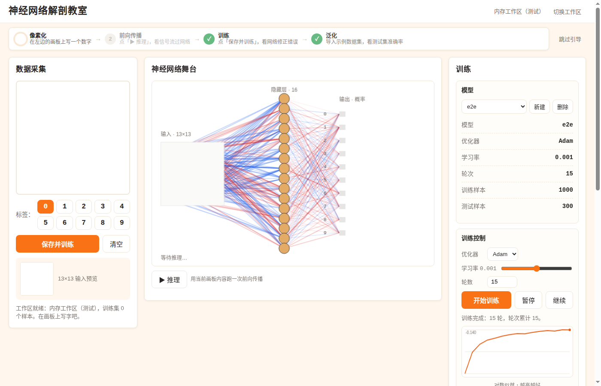

# 神经网络解剖教室

一个**纯静态网页**：在浏览器里手写数字，亲眼看着 169→16→10 的全连接网络做前向传播、反向训练，并在测试集上评估泛化。零 npm 依赖、零后端——本地起个静态服务即用。



## 运行方式

**Mac（推荐）：** 双击 `tools/serve.command`，会自动起本地服务并用 Chrome 打开。

**任意系统：**

```bash
cd nn-anatomy2
python3 -m http.server 8080
# 浏览器打开 http://127.0.0.1:8080/index.html
```

## 浏览器要求

- **Chromium 内核**：桌面版 Chrome / Edge（需要 `File System Access API` 的 `showDirectoryPicker` 来读写真实文件夹）。
- **为什么不用 Firefox / Safari**：Firefox 至今不支持 `showDirectoryPicker`；Safari 支持不完整。无痕/隐私窗口下文件权限可能受限，建议用普通窗口。
- 触屏：画板用 Pointer Events，手机/平板可直接手写（桌面端 768px 以下自动单列布局）。

## 工作区：一个真实文件夹

第一次打开会让你**选择一个文件夹作为工作区**。所有数据都以普通文件存在里面：

```
<工作区>/
  samples/
    train/<标签>/*.png      # 手写 260×260 PNG（黑字白纸）
    test/<标签>/*.png
    manifest.json           # 样本清单（id/标签/来源/尺寸）
  models/
    <模型名>.nnmodel.json    # 权重 + 优化器状态 + 训练元信息
```

换电脑时整个文件夹拷走即迁移。示例数据集（一键导入，1000 训练 / 300 测试，13×13 MNIST 风格）存在仓库 `data/sample-digits/`，导入后进 `samples/`。

## 玩法（四阶段引导）

页面顶部有一条教学引导，按顺序体验：

1. **像素化**——在左边画板写一个数字，看它被压缩成 13×13 输入；
2. **前向传播**——点「▶ 推理」，看信号粒子流过 16 个隐藏节点，输出 10 个概率柱；
3. **训练**——点「保存并训练」：红色误差粒子反向流动，权重边泛起脉冲，输出柱对比更新前后；
4. **泛化**——一键导入示例数据集，训练 15 轮，在测试集上看准确率、每类准确率和 10×10 混淆矩阵（点格子可看错分的样本原图、删错标）。

点击隐藏节点可看它 169 个输入权重的热力图；再点一次恢复。

## 架构

```
index.html
js/
  network.js / optimizer.js / rng.js   # 引擎：169→16→10 MLP，LeakyReLU(0.01)，Softmax
  trainer.js                           # trainEpochs / evaluate / inferWithTrace（带 trace 的前向）
  preprocess.js                        # 260×260 → 居中 → 13×13 → 归一化
  dataset.js                           # 示例数据集导入 / loadSamples（墨=1 极性解码）
  workspace.js                         # 工作区：真实目录 handle / OPFS / 内存三后端
  ui/
    app.js        # 装配：画板+标签+保存、模型状态、教学引导接线
    drawing.js    # 260×260 手写画板（Pointer Events）
    stage.js      # 神经网络舞台：Canvas 2D，粒子动画
    particles.js  # 纯数学粒子系统（无 DOM）
    panel.js      # 训练控制 + 指标 + 混淆矩阵
    dataset-viewer.js  # 数据集管理 modal
    lesson.js     # 四阶段引导条
```

- **零运行时依赖**：ES Modules + Canvas 2D + File System Access API，不跑 `npm install`。
- **数值约定**：网络输入统一"墨=1"——手写 PNG（黑字白纸）解码为 `1 − gray/255` 再走预处理；MNIST 样本（白字黑底）直接 `gray/255`。
- **可复现**：`trainEpochs` 支持 `startEpoch`，分块训练与一次训练的 shuffle 序列 bit-identical；暂停/继续不断 Adam 状态。
- 模型文件是 JSON（含 Adam 的 m/v/t），删了重建即可；权重出现 NaN 时面板会报错并提供「重置模型」。

## 开发命令

```bash
node --test tests/*.test.js     # 逻辑单测（52）
node tests/walkthrough.js       # UI 走查：空状态/按钮态/NaN恢复/reduced-motion/触屏/移动端
node tests/e2e.js               # 端到端：导入1300张 → 建模(seed=23) → 训练15轮 → acc≥0.9 → 存取round-trip
```

各烟雾页（headless Chromium 验证用）：`tests/browser/ui-task9.html`、`ui-task10.html`、`ui-task11.html`、`walkthrough.html`、`e2e.html`。

## 已知限制

- Headless 测试环境（CI/沙盒）里 IndexedDB/OPFS 的 promise 不 resolve、大尺寸 PNG 的 `createImageBitmap` 会挂起——走查与 E2E 用 `MemoryBackend` + 小尺寸样本；以下需在**真机 Chrome**确认：260×260 手写 PNG 端到端解码、1300 张全量导入性能、真实目录持久化、原生 rAF 动画流畅度。
- 示例数据集准确率与初始化 seed 相关（16 个隐藏单元很小，init lottery 明显）；E2E 用固定 seed=23（15 轮 Adam 可达 ~0.90），日常使用多试几次或多训几轮。
